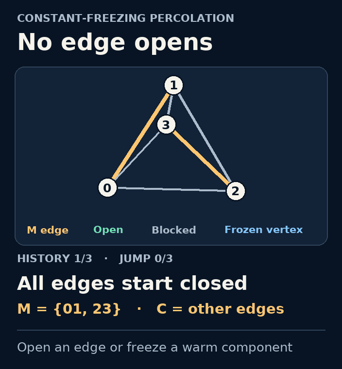

# A finite counterexample to positive association for constant-freezing percolation

  

Mottram asked whether the final open-edge law of percolation with constant freezing is positively associated. On $K_4$, let $A$ be the event that a fixed perfect matching has an open edge and let $B$ be the event that its complement has an open edge. Both events are increasing. Their covariance is strictly negative for every $0<\alpha\leq 1/1000$.

[Read the paper (PDF)](paper/manuscript.pdf) · [Proof at a glance](proof/PROBLEM_AND_PROOF.md) · [Exact replay](REPRODUCIBILITY.md)

## Watch the three histories

[Download the offline explorer](https://raw.githubusercontent.com/DannyExperiments/constant-freezing-percolation-counterexample/3677d24af75d4f415dbb2e8763aa8df347de4c90/visualization/freezing-histories-explorer.zip), extract it, and open `index.html` in a browser. Rotate the tetrahedron and step through each history to see its exact jump factors.

The elementary proof starts from three histories of the four labeled vertices. A separate exact certificate gives the sign for these two events at every positive rate. The covariance crosses zero at a unique rate between 0.0407722920 and 0.0407722921. The crossing only concerns these two events.

## Sources and checks

- [Mottram’s thesis, §3.1.4 and Example 3.1.5](https://doi.org/10.17863/CAM.15980)
- [Literature audit](audits/public_safe_reports/LITERATURE_AUDIT.md)
- [Mathematical audit](audits/public_safe_reports/MATHEMATICAL_AUDIT.md)
- [Scope and limitations](CLAIM_SCOPE_AND_LIMITATIONS.md)
- [Provenance](PROVENANCE.md) and [AI credits](AI_DISCLOSURE.md)

Internal mathematical review is complete. See the [release and verification status](STATUS.md).

[Release v1.0.0](https://github.com/DannyExperiments/constant-freezing-percolation-counterexample/releases/tag/v1.0.0) · [Version DOI](https://doi.org/10.5281/zenodo.24567309)
